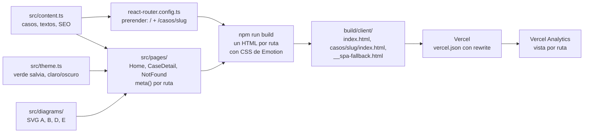
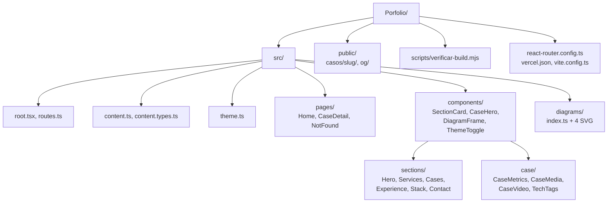

# Diseño técnico del sitio web del portfolio

Artefacto SDD completo: Engram `sdd/portfolio/design`. Propuesta: `sdd/portfolio/proposal` (v3, aprobada el 2026-11-02).

**Qué se cambió:** se definió cómo se construye el sitio. Se usa React Router v7 en "modo framework" (la estructura de proyecto donde React Router maneja el build y el prerender) con la carpeta `src/`. Los textos y los casos viven en `src/content.ts`, y todavía no hay código.

**Por qué:** LinkedIn y WhatsApp leen el HTML sin ejecutar JavaScript. Cada ruta, como `/casos/carga-masiva-productos`, necesita llegar con su título, su Open Graph y sus estilos ya incluidos en el HTML.

**Cómo funciona ahora:** `react-router.config.ts` lista las rutas a prerenderizar leyendo los slugs de `src/content.ts`. Cada página declara su título y Open Graph con la función `meta`. En el build, el CSS que genera Emotion queda dentro de cada HTML de `build/client/`, y Vercel sirve esos archivos (ver diagramas).

**Decisiones:** se eligió el modo framework porque `meta` y el prerender son oficiales de React Router; `vite-react-ssg` queda como plan B. Las páginas importan `src/content.ts` directo, sin loaders, para que un slug desconocido muestre `NotFound` sin errores. Las pruebas usan Vitest con Testing Library, más un script que revisa el HTML generado. La lista de nombres confidenciales queda en un archivo local fuera de git, porque el repo es público.

**A tener en cuenta:** la extracción del CSS de Emotion y la ausencia de parpadeo claro/oscuro no están verificadas. Por eso la primera tarea del slice 1 es un spike de verificación con Lighthouse. Si falla, se pasa a `vite-react-ssg` antes de escribir secciones. Un slug inexistente devuelve código 200 con la página `NotFound`, no un 404 real.

