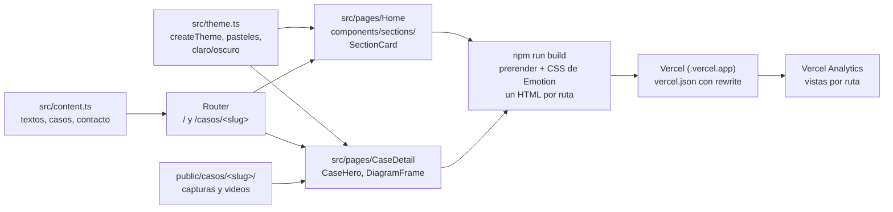

# Propuesta del sitio web del portfolio (v3)

Artefacto SDD completo: Engram `sdd/portfolio/proposal`. Decisiones: `sdd/portfolio/decisiones-propuesta` y `sdd/portfolio/decisiones-propuesta-2`.

**Qué se cambió:** se definió el sitio con Vite + React + TypeScript + MUI, sin backend. Hay un Inicio con seis secciones y una página por proyecto en `/casos/<slug>`. Los textos viven en `src/content.ts` y el tema en `src/theme.ts`. Todavía no hay código.

**Por qué:** Jorge necesita mostrar resultados a dueños de negocio sin exponer código ni datos de clientes. Por ejemplo, el Caso A pasa de ~43,5 h estimadas a mano a 6,5 min medidos.

**Cómo funciona ahora:** el router genera una ruta por cada caso de `src/content.ts`. En el build, cada ruta se prerenderiza a un HTML con su título, su Open Graph y el CSS que genera Emotion. Vercel sirve esos archivos y Vercel Analytics cuenta las visitas por ruta (ver diagrama).

**Decisiones:** se eligieron Vite y MUI porque son el stack de Jorge, y por eso se descartaron Next.js y Tailwind. Se reemplazó "Ver código" por páginas de detalle. El repo espejo de Dallas Note y publicar `catalog-bulk-import` quedan descartados hasta que un cliente técnico pida ver código.

**A tener en cuenta:** si no se configura la cache de Emotion en el build, el HTML sale sin estilos. El peso de MUI y el contraste de los pasteles pueden bajar Lighthouse por debajo de 90. Son ~2.500-2.800 líneas en 6 PR, y queda abierto el color de acento.

